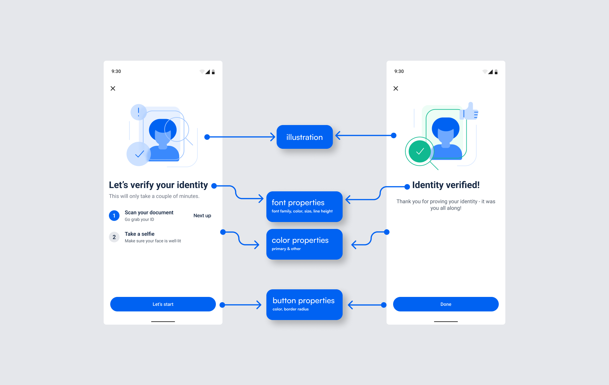
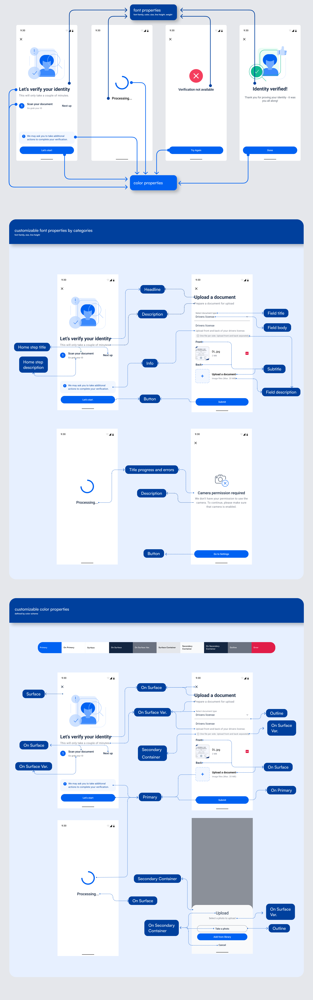
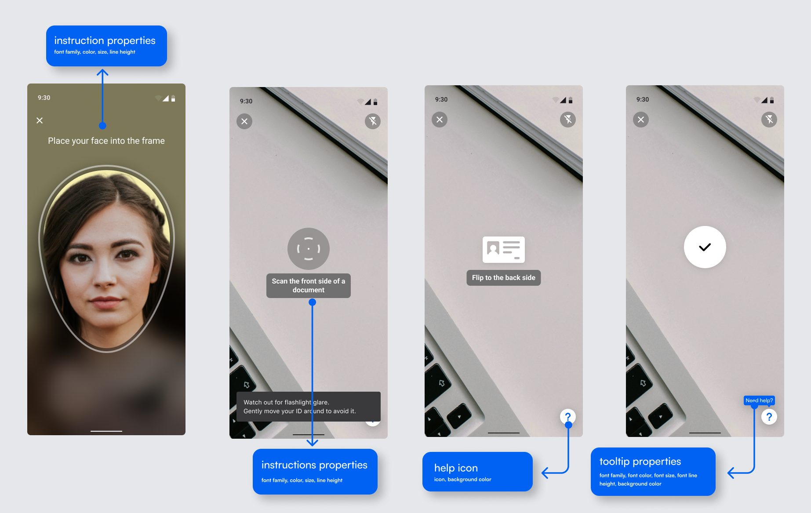
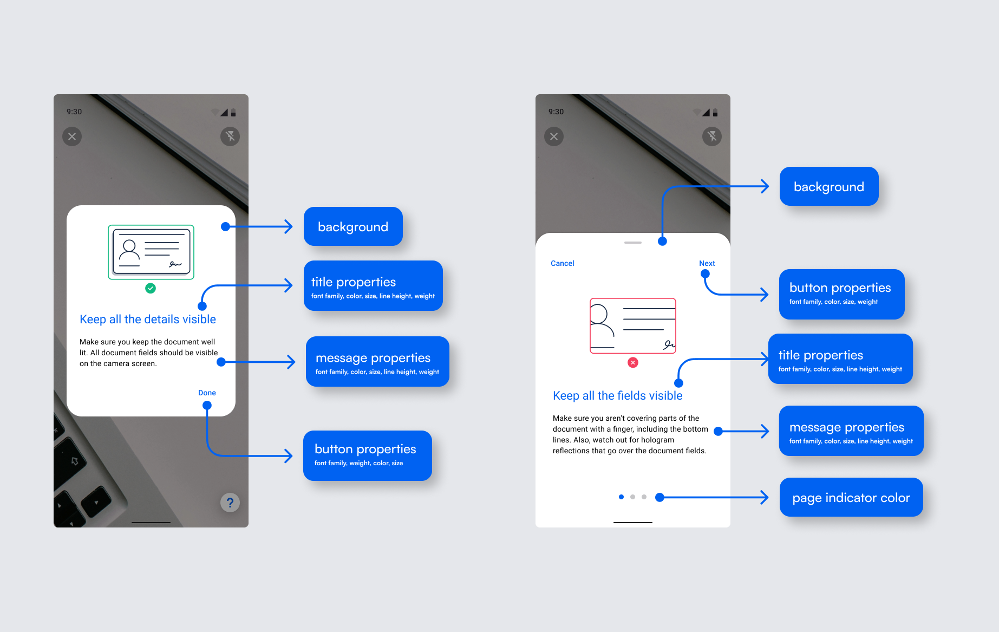

<p align="center" >
  
</p>

# Microblink Platform SDK for Android
*Microblink Platform* Android SDK enables seamless and secure user authentication by integrating advanced identity verification features, such as document scanning, facial recognition, and real-time validation, into your application. It helps businesses ensure compliance, prevent fraud, and enhance user trust with minimal development effort.

The SDK comes in two parts:

* **`microblink-platform`**: the drop-in UI. You start a verification with one call and get its outcome back; the SDK shows every screen.
* **`microblink-platform-engine`**: the engine underneath. It runs the verification and shows the scanner and face screens. Depend on it alone if you build your own UI (see [Building your own UI](#engine)).

Upgrading from 1.x? See the [migration guide](Migration%20guide.md).

## Table Of Contents
  * [Quick start with sample apps](#quick-start-with-sample-apps)
  * [Requirements](#requirements)
     * [Android version](#android-version)
     * [Build tools](#build-tools)
     * [Processor architecture](#processor-architecture)
  * [SDK integration](#sdk-integration)
  * [SDK flow](#sdk-flow)
     * [Creating the transaction](#creating-the-transaction)
     * [Starting the SDK](#starting-the-sdk)
     * [Retrieving information](#retrieving-information)
  * [Backend compatibility](#backend-compatibility)
  * [Customizing the look](#customizing-the-look)
  * [Changing default strings and localization](#changing-default-strings-and-localization)
     * [Changing strings in the existing language](#changing-existing-string)
     * [Adding new language](#adding-new-language)
  * [Building your own UI](#engine)
  * [Kotlin documentation](#kotlin-documentation)


## <a name="quick-start-with-sample-apps"></a> Quick start with sample apps
Clone this repository and open the [**MicroblinkPlatformSample**](https://github.com/MicroblinkPlatform/microblink-platform-android/tree/main/MicroblinkPlatformSample) Android Studio project. It has two **Kotlin** sample apps:

* **`app`** starts the drop-in UI ([`MainActivity.kt`](https://github.com/MicroblinkPlatform/microblink-platform-android/blob/main/MicroblinkPlatformSample/app/src/main/java/com/microblink/platform/sample/MainActivity.kt)).
* **`app-custom-ui`** runs the verification on the engine with screens of its own (see [Building your own UI](#engine)).

Both apps create their transaction in the app, so you can try the SDK without a backend. Before you run them, fill in the placeholders at the top of [`TransactionClient.kt`](https://github.com/MicroblinkPlatform/microblink-platform-android/blob/main/MicroblinkPlatformSample/transaction-client/src/main/java/com/microblink/platform/sample/transaction/TransactionClient.kt): the API URL, client ID, client secret and workflow ID Microblink gave you.

> [!WARNING]
> `TransactionClient` is for testing only. It puts your service account's client secret in the app, where anyone who unzips the APK can read it. Use a test service account and keep its credentials out of version control. In your own app, let your backend create the transaction (see [Creating the transaction](#creating-the-transaction)).

## <a name="requirements"></a> Requirements
### <a name="android-version"></a> Android version
*Microblink Platform* SDK requires **Android 8.0** (API level **26**) or newer.

### <a name="build-tools"></a> Build tools
The SDK's UI is built on Jetpack Compose 1.12 and Material 3 1.5, whose libraries require:

* **Android Gradle Plugin 9.1** or newer
* **compileSdk 37** or newer
* **Java 17**

### <a name="processor-architecture"></a> Processor architecture
*Microblink Platform* SDK is distributed with **ARMv7** and **ARM64** native library binaries.

*Microblink Platform* is a native library written in C++ and available for multiple platforms. Because of this, *Microblink Platform* cannot work on devices with obscure hardware architectures. We have compiled SDK's native code only for the most popular Android [ABIs](https://en.wikipedia.org/wiki/Application_binary_interface).

If you are combining *Microblink Platform* library with other libraries that contain native code in your application, make sure to match the architectures of all native libraries. For example, if the third-party library has only ARMv7 version, you must use exactly ARMv7 version of *Microblink Platform* with that library, but not ARM64. Using different architectures will crash your app at the initialization step because JVM will try to load all its native dependencies in the same preferred architecture and fail with `UnsatisfiedLinkError`.

To avoid this issue and ensure that only architectures supported by the *Microblink Platform* library are packaged in the final application, add the following statement to your `android/defaultConfig` block inside `build.gradle.kts`:

```kotlin
android {
    ...
    defaultConfig {
        ...
        ndk {
            // Tells Gradle to package the following ABIs into your application
            abiFilters += listOf("armeabi-v7a", "arm64-v8a")
        }
    }
}
```

## <a name="sdk-integration"></a> SDK integration
The SDK is on Maven Central. Add the platform BOM, the SDK, and the scanner SDKs your workflows use to your `build.gradle.kts`. The BOM sets the versions of all of them, so leave the versions out:

```kotlin
dependencies {
    implementation(platform("com.microblink:microblink-platform-bom:2.0.0"))
    implementation("com.microblink:microblink-platform")

    // Add only the scanner SDKs your workflows use
    implementation("com.microblink:blinkid-verify-ux") // document scanning and verification
    implementation("com.microblink:blinkcard-ux")      // payment card scanning
    implementation("com.microblink:biometrics-ux")     // face capture
}
```

| Workflow step | Scanner SDK |
| --- | --- |
| Scan ID, Scan & Verify ID | `blinkid-verify-ux` |
| Scan Payment Card | `blinkcard-ux` |
| Face capture (selfie) | `biometrics-ux` |

If a workflow reaches a step whose scanner SDK isn't in the app, the verification fails at that step with `EngineError.MissingScannerSdk`. Leaving out the SDKs you don't use keeps your app smaller.

Check out the sample app for an example of using a TOML version catalog.

## <a name="sdk-flow"></a> SDK flow
### <a name="creating-the-transaction"></a> Creating the transaction
Every verification runs one transaction, which **your backend** creates through the Microblink Platform API with your service account credentials. The response carries an `sdkConfiguration` value. Your backend passes it to the app, and the app passes it to the SDK.

* Never create the transaction in the app: that would ship your service account's secret with it. The sample apps do it only so you can try the SDK without a backend.
* The `sdkConfiguration` authorizes that one transaction only. Fetch a new one for every verification, and treat it as a secret.
* The end-user's consent is part of creating the transaction, so the SDK no longer asks for it.

> [!IMPORTANT]
> To create transactions you need a workflow and service account credentials. [Please reach out to us to obtain them](https://microblink.com/contact-us/).

### <a name="starting-the-sdk"></a> Starting the SDK
To start the SDK, call `MicroblinkPlatform.startVerification` with an `Activity` and the configuration:

```kotlin
MicroblinkPlatform.startVerification(
    activity = this,
    configuration = MicroblinkPlatformConfiguration(
        engine = EngineConfiguration(
            service = ServiceSettings(sdkConfiguration = sdkConfiguration), // from your backend
        ),
        resultListener = resultListener,
        ui = UiConfiguration(
            // customize the UI if needed
        ),
        // Optional: receives the card a Scan Payment Card step read
        cardScanResultListener = { card ->
            // card.toString() is masked, so logging it doesn't leak the card number
            Log.i("MainActivity", "Card scanned: $card")
        },
    ),
)
```

Only one verification runs at a time: calling `startVerification` while one is running throws `IllegalStateException`.

The SDK asks for the camera permission itself when a step needs the camera. Its manifest declares `CAMERA` and `INTERNET`.

`ServiceSettings` also takes a `retryPolicy` (`NetworkRetryPolicy`), which sets how many times and how often the SDK retries a failed request before it reports a failure.

### <a name="retrieving-information"></a> Retrieving information
The outcome arrives on `MicroblinkPlatformResultListener`, on the main thread, once the user leaves the verification screens. Exactly one of its functions is called per verification:

```kotlin
private val resultListener = object : MicroblinkPlatformResultListener {
    override fun onVerificationFinished(outcome: SessionOutcome.Verification) {
        when (outcome.state) {
            VerificationState.Accept -> // Handle successful verification
            VerificationState.Reject -> // Handle failed verification
            VerificationState.Review -> // Handle verification that requires manual review
        }
        val transactionId = outcome.transactionId
    }

    override fun onVerificationCanceled(outcome: SessionOutcome.Canceled) {
        // The user left the verification before it finished (back navigation or close button).
        // transactionId is null if the transaction never started.
        val transactionId = outcome.transactionId
    }

    override fun onVerificationFailed(transactionId: String?, error: EngineError) {
        // The verification ended on an error the user can't retry, for example:
        // EngineError.NoNetwork, EngineError.VerificationUnavailable,
        // EngineError.MissingScannerSdk (a scanner SDK is missing from the app),
        // EngineError.UnsupportedWorkflowVersion (see Backend compatibility)
    }
}
```

`cardScanResultListener` receives a `CardScanResult` (card number, expiry date, owner and CVV) as soon as the backend accepts the scanned card. The card is complete: the masking a workflow configures applies only to what is sent to the backend.

## <a name="backend-compatibility"></a> Backend compatibility
Each workflow is built for an SDK version. When a verification starts, the SDK checks it: a workflow built for an **older major.minor** version than the SDK's is refused. The SDK then ends the transaction and reports `EngineError.UnsupportedWorkflowVersion`, which carries both versions. For example, SDK 2.0.0 runs workflows built for 2.0 or later and refuses one built for 1.10.

To fix it, update the workflow to the SDK's major.minor version or a later one.

## <a name="customizing-the-look"></a> Customizing the look
It is not possible to move elements of the UI around, remove parts of the UI, or add new parts.

The *Microblink Platform* SDK comes with the ability to customize some aspects of the UI by using the UI theming. The screens can be customized to fit your app’s look and feel through `UiConfiguration`. Its colors and fonts also style the scanner and face screens.

The SDK uses a light theme in 2.0.0. It doesn't follow the phone's dark mode setting.

<p align="center"></p>
<p align="center"></p>

### Colors
Set a Material 3 `ColorScheme`. It colors the SDK's screens, and its `primary`, `onPrimary`, `surface` and `onSurface` also color the scanner and face screens:

```kotlin
ui = UiConfiguration(
    colorScheme = lightColorScheme(
        primary = Cobalt,
        background = Color.White,
    )
)
```

### Images
Change the images on the home screen, the result screens and the camera permission screen:

```kotlin
ui = UiConfiguration(
    images = MicroblinkPlatformImages(
        home = R.drawable.my_home,
        verificationSuccess = R.drawable.my_verification_success,
        verificationFail = R.drawable.my_verification_fail,
        verificationReview = R.drawable.my_verification_review,
        cameraPermission = R.drawable.my_camera_permission,
    ),
)
```

### Text styles
`MicroblinkPlatformTypography` has one `TextStyle` per kind of text: `heading`, `description`, `subtitle`, `homeStepTitle`, `homeStepDescription`, `info`, `fieldTitle`, `fieldBody`, `fieldDescription`, `titleProgressAndErrors`, `dialogTitle` and `button`. The [Kotlin documentation](#kotlin-documentation) says where each one is used.

To change only the font, pass a `FontFamily` to the default typography. Sizes, weights and line heights stay the same:

```kotlin
private val allerta = FontFamily(Font(R.font.allerta, FontWeight.Normal))

ui = UiConfiguration(
    typography = MicroblinkPlatformTypography.default(allerta),
)
```

To change other parameters, set the style you need:

```kotlin
ui = UiConfiguration(
    typography = MicroblinkPlatformTypography(
        heading = TextStyle(
            fontWeight = FontWeight.Bold,
            fontSize = 28.sp,
            lineHeight = 32.sp,
            color = DeepBlue,
        ),
    ),
)
```

The scanner and face screens take their text styles from `scannerTypography` (`ScannerTypography`): the onboarding screen, the help and error dialogs, the scanning instructions, the help tooltip, the loading screen and the face capture guidance. A style there replaces that text's whole default style, so set its size too. A style you leave `null` keeps the scanner's own:

```kotlin
ui = UiConfiguration(
    scannerTypography = ScannerTypography(
        onboardingTitle = TextStyle(fontFamily = allerta, fontSize = 24.sp, fontWeight = FontWeight.Bold),
        scanningInstructions = TextStyle(fontFamily = allerta, fontSize = 16.sp),
    ),
)
```

<p align="center"></p>
<p align="center"></p>

### Button shape
`buttonShape` sets the shape of every button on the SDK's screens and their dialogs:

```kotlin
ui = UiConfiguration(
    buttonShape = RoundedCornerShape(8.dp),
)
```

## <a name="changing-default-strings-and-localization"></a> Changing default strings and localization
SDK is available in English. You can modify all of the strings and add your own language. For more information on how localization works in Android, check out the [official Android documentation](https://developer.android.com/guide/topics/resources/localization).

### <a name="changing-existing-string"></a> Changing existing strings
To modify an existing string, the best approach would be to:

1. Check out all the available strings you can change in the [`strings.xml`](https://github.com/MicroblinkPlatform/microblink-platform-android/tree/main/strings/strings.xml).
2. Choose a string key that you want to change. For example: `<string name="mbp_home_start_button">Let\'s start</string>`.
3. In your project, create a file `strings.xml` in the folder `res/values` if it doesn't already exist.
4. Create an entry in the file with the value for the string. For example: `<string name="mbp_home_start_button">Begin</string>`.
5. Repeat for all the strings you wish to change.

The scanner SDKs' own strings, such as the face capture guidance (`mb_biom_guidance_*`), can be overridden the same way.

### <a name="adding-new-language"></a> Adding new language
The *Microblink Platform* SDK can easily be translated into other languages. The [`strings.xml`](https://github.com/MicroblinkPlatform/microblink-platform-android/tree/main/strings/strings.xml) contains all the strings used in the *Microblink Platform* library. In order to make e.g. German translation, create a folder `res/values-de` in your project and create a `strings.xml` inside it. Then, open that file and create entries for strings you wish to translate. E.g., for the string `mbp_home_start_button`, you should create an entry like this: `<string name="mbp_home_start_button">Los geht\'s</string>`

## <a name="engine"></a> Building your own UI
If you want your own screens instead of the SDK's, depend on the engine alone:

```kotlin
dependencies {
    implementation(platform("com.microblink:microblink-platform-bom:2.0.0"))
    implementation("com.microblink:microblink-platform-engine")
    // plus the scanner SDKs your workflows use, as above
}
```

The engine runs the transaction your backend created, one step at a time, and still shows the scanner and face screens itself. Your UI shows everything else: the start form, form steps, document uploads, the camera permission request and the result.

The [`app-custom-ui`](https://github.com/MicroblinkPlatform/microblink-platform-android/tree/main/MicroblinkPlatformSample/app-custom-ui) sample app does all of this: a screen for each kind of step, its own theme, and a `ScannerAppearance` that gives the scanner and face screens the same colors and fonts. `VerificationViewModel.kt` shows how each `StepResult` becomes a screen.

```kotlin
// In a ViewModel, or another owner that survives configuration changes
val start = Engine.startSession(
    EngineConfiguration(service = ServiceSettings(sdkConfiguration = sdkConfiguration)),
).getOrElse { /* invalid configuration, or EngineException(UnsupportedWorkflowVersion) */ return }

val session = start.session
var step: StepResult = start.first
while (step !is StepResult.Finished) {
    step = when (step) {
        is StepResult.Ready -> when (val action = step.action) {
            is StepAction.Start -> session.next(/* StepInput.FormSubmission for action.form */)
            is StepAction.EngineStep -> session.next() // the engine runs the scanner
            is StepAction.InputStep -> session.next(/* your form or upload input for action.request */)
        }
        is StepResult.Blocked -> session.next() // after the user grants the camera permission
        is StepResult.Failed -> session.next(/* the same step again, as step.retryAction says */)
        is StepResult.Finished -> step
    }
}
val outcome = (step as StepResult.Finished).outcome
```

* `Session.next` advances by exactly one step and returns what to do next. A wrong input for the current step comes back as `StepResult.Failed` with `EngineError.InvalidNextInput`; it isn't thrown.
* `Session.status` is a `StateFlow<EngineStatus>` to drive loaders and upload progress.
* `Session.cancel(CancelReason.UserCanceled)` ends the session.
* The engine follows which of your Activities is in front through `androidx.startup` (`EngineInitializer`), so you never hand it one. If your app turns off automatic initialization, initialize `EngineInitializer` in `Application.onCreate`.
* The look of the scanner and face screens comes from `EngineConfiguration.appearance` (`ScannerAppearance`: colors and `ScannerTypography`).

See the [engine's Kotlin documentation](https://microblinkplatform.github.io/microblink-platform-android/microblink-platform-engine/com.microblink.platform.engine/index.html) for every step, input and error.

## <a name="kotlin-documentation"></a> Kotlin documentation
* [Drop-in UI (`microblink-platform`)](https://microblinkplatform.github.io/microblink-platform-android/microblink-platform/com.microblink.platform/index.html)
* [Engine (`microblink-platform-engine`)](https://microblinkplatform.github.io/microblink-platform-android/microblink-platform-engine/com.microblink.platform.engine/index.html)
